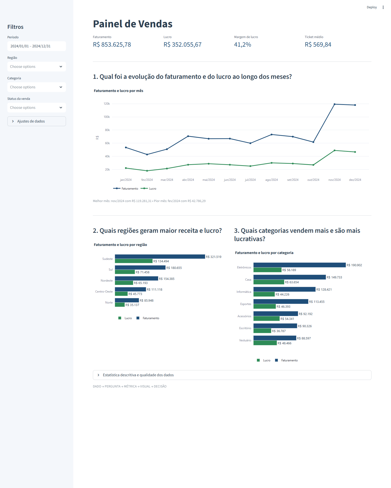

# Painel de Vendas

Implementação em Python do planejamento de dashboard, usando **Streamlit** (interface) e
**Plotly** (gráficos) sobre a base `Vendas_Organizado.xlsx` (1.500 vendas).

O painel segue o rascunho da seção 8: uma única tela, com os KPIs no topo e três gráficos,
um para cada pergunta de negócio da seção 4.

## Como rodar

```powershell
pip install -r requirements.txt
streamlit run app.py
```

O navegador abre em `http://localhost:8501`.

## Estrutura

| Arquivo | Papel |
| --- | --- |
| `app.py` | Tela do painel: KPIs, os três gráficos e os filtros |
| `src/dados.py` | Carga e limpeza da base (seções 2 e 3) |
| `src/kpis.py` | Métricas e estatística descritiva (seções 5 e 6) |
| `src/graficos.py` | Os três gráficos e a paleta de cores (seções 7 e 9) |
| `.streamlit/config.toml` | Tema azul, para o vermelho ficar reservado a alertas |

## Do planejamento para o código

### Seção 3 — Qualidade dos dados

Cada problema anotado no papel virou um tratamento explícito em `src/dados.py`, sempre
sinalizando em vez de apagar linhas:

- **126 nulos em `Avaliacao_Cliente`** — permanecem `NaN` e ficam fora da média, porque
  "sem avaliação" não é o mesmo que "nota zero".
- **0 duplicados** — verificado por linha inteira e por `ID_Venda`.
- **Inconsistência de texto** — `_canonizar()` unifica variantes (`APLICATIVO`/`Aplicativo`,
  `  Casa  `/`Casa`, `Acessorios`/`Acessórios`) comparando os textos sem acento nem caixa e
  elegendo a grafia mais frequente. Resultado: categorias 11 → 7, pagamentos 8 → 5, canais 6 → 5.
- **Outliers** — marcados pelo critério de Tukey (1,5 × IQR) em `Quantidade`, `Preco_Unitario`,
  `Valor_Total` e `Lucro`; 179 registros. A exclusão é opcional, em "Ajustes de dados".
- **Alta cardinalidade** — `ID_Venda` e `Data_Venda` são usados como chave e eixo, nunca como
  filtro de seleção.

Dois problemas não previstos no planejamento apareceram na base e também foram tratados:
uma venda "Concluída" com quantidade e valor zerados, e uma venda isolada em 05/09/2025 —
oito meses depois do resto da base, que abriria um buraco no gráfico de linha. O filtro de
período abre no bloco contínuo de operação (01/01/2024 a 31/12/2024).

### Seções 4, 5 e 7 — Perguntas, métricas e gráficos

| Pergunta | Métrica | Gráfico |
| --- | --- | --- |
| Evolução do faturamento e do lucro ao longo dos meses | Soma de `Valor_Total` e `Lucro` por mês | Linha |
| Regiões que geram maior receita e lucro | Soma de `Valor_Total` e `Lucro` por região | Barras |
| Categorias que vendem mais e são mais lucrativas | Soma de `Valor_Total` e `Lucro` por categoria | Barras |

Os KPIs do topo trazem faturamento, lucro, margem e ticket médio (`Valor_Total` / nº de vendas).

Uma observação sobre a margem: o planejamento previa *média de `Margem_Lucro`*, mas o painel
usa `soma(Lucro) / soma(Valor_Total)`. A média simples trata uma venda de R$ 20 e outra de
R$ 12.000 com o mesmo peso e distorce o número; a margem consolidada responde "de cada real
faturado, quanto sobrou". A média por venda continua disponível no expansor de estatística
descritiva, junto com mediana, desvio padrão, mínimo/máximo e quartis (seção 6).

### Seção 9 — Cores

Azul `#1F4E79` para o faturamento e como cor principal, verde `#2E8B57` para o lucro. O
vermelho `#C0392B` fica reservado a alertas e por isso o tema do Streamlit foi trocado de
vermelho para azul — assim, quando o vermelho aparecer, ele significa alguma coisa.

No rascunho o lucro foi desenhado em vermelho, mas a própria seção 9 define verde como a cor
do lucro e vermelho como cor de alerta. O painel segue a seção 9.

### Seção 10 — Filtros

Período, região, categoria e status da venda na barra lateral, afetando os três gráficos.

## Captura


